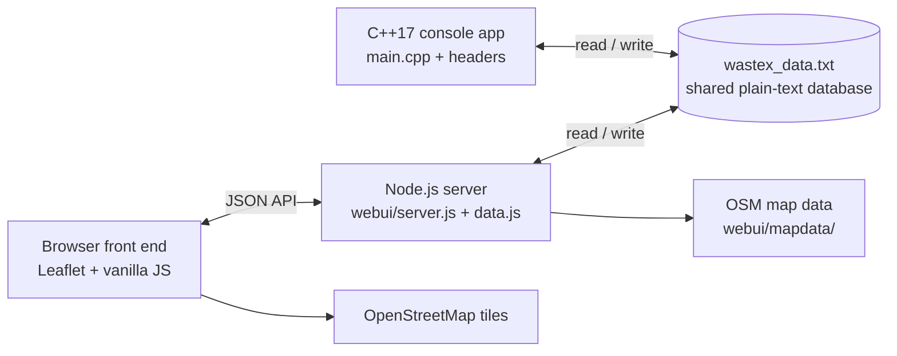

<div align="center">


# KUET WasteX

**Smart campus waste management: a hand-built C++ data-structures engine with a live web dashboard.**

Track every bin on campus, collect in priority order, and drive the shortest routes.


[Overview](#overview) · [Features](#features) · [Quick start](#quick-start) · [Architecture](#architecture) · [Algorithms](#data-structures-and-algorithms) · [Screenshots](#screenshots) · [Team](#project-team)

</div>

---

## Table of contents

1. [Overview](#overview)
2. [Features](#features)
3. [Quick start](#quick-start)
4. [Architecture](#architecture)
5. [Data structures and algorithms](#data-structures-and-algorithms)
6. [Data file format](#data-file-format)
7. [Screenshots](#screenshots)
8. [Tech stack](#tech-stack)
9. [Repository structure](#repository-structure)
10. [Project team](#project-team)
11. [Roadmap](#roadmap)
12. [License and credits](#license-and-credits)
13. [Notes and limitations](#notes-and-limitations)

## Overview

Overflowing bins, late pickups and wasted truck trips are everyday problems on a university campus. KUET WasteX is a coursework project that tackles them with a solid-waste management system for the KUET campus. Every core structure, from the linked list to the Dijkstra router, is written from scratch.

The system ships as two programs that share one plain-text database, `wastex_data.txt`:

- **A C++17 console application.** This is the core engine. It manages bins, users, collection requests and the campus road graph with a linked list, stack, FIFO queue, max-heap priority queue, binary search tree, weighted graph (BFS and DFS), Dijkstra, merge sort and binary search.
- **A Node.js web dashboard.** A role-based front end served by a dependency-free HTTP server that uses Node built-ins only. It adds live OpenStreetMap tracking of bins and the collection truck, a visual campus road network, and analytics screens.

The model covers 15 campus locations joined by 29 weighted road segments. Each bin reports a fill level and a fill rate per hour. From those two values the system derives a status and a collection priority:

| Fill level | Status |
| --- | --- |
| 90% or above | `CRITICAL` |
| 75% to 89% | `HIGH` |
| 50% to 74% | `MODERATE` |
| Below 50% | `NORMAL` |

Priority is computed as `fill × 0.6 + fill rate × 0.4`, so a bin that is both nearly full and filling quickly goes to the front of the queue.

## Features

### Admin

- Dashboard with live system counts, a bin status summary and a collection overview.
- Add, update, search, list and delete bins, with fill level, fill rate, status and priority on each.
- View, search and cancel collection requests, and assign drivers to them.
- Manage users: list accounts, add User, Driver or Admin accounts, and remove accounts.
- System statistics and a one-screen overview of the whole system.
- Interactive campus road network: explore the weighted graph, place locations on the map, and preview the shortest route between any two locations.
- Sort bins by fill, fill rate, priority or ID, and binary search a bin by ID with a visible comparison count.

### User

- Register and sign in with self-service credentials.
- Browse nearby bins ordered by shortest walking distance (Dijkstra).
- File collection requests for bins and follow their status.
- Review collection history and system statistics.

### Driver

- View assigned collection requests and priority bins.
- Run smart collection: bins are collected in priority order, with the shortest route between stops.
- Find the shortest route between two campus locations.
- Collect a bin and update the truck's current location.
- View collection history.

On top of all three roles, the web dashboard adds live OpenStreetMap tracking. Bins appear at their campus coordinates, the truck moves along the planned route, admins can place campus locations on the map, and a branded loading screen appears when a session opens.

## Quick start

### Prerequisites

- **Console app:** Windows with a C++17 compiler (`g++`, MinGW-w64). It uses Windows console APIs (`windows.h`, masked password input through `_getch`).
- **Web dashboard:** Node.js (LTS). No `npm install` is needed, because the server uses only Node built-ins.
- **Internet access** for OpenStreetMap tiles and the Leaflet CDN.

### Installation

Clone or copy the repository into a local folder. Nothing else needs installing beyond the two prerequisites.

### Run the console application

The quickest way is to double-click `WasteX.bat`, which builds with all warnings enabled and launches the app. To build manually:

```
g++ -std=c++17 main.cpp Graph.cpp LinkedList.cpp -o KUETWasteX.exe
KUETWasteX.exe
```

With make:

```
make          # build KUETWasteX.exe
make WasteX   # build and run
```

Optional: run `setup.bat` once to add the project folder to your user PATH. After that you can type `WasteX` from any terminal. `clear.bat` (or `make reset`) deletes the saved data so the next launch starts fresh.

### Run the web dashboard

Double-click `start-webui.bat`, or run:

```
node webui\server.js
```

Then open http://localhost:3000 in a browser. The batch file opens it for you. Set the `PORT` environment variable to use a different port.

Demo accounts for the Driver and User roles are listed on the login screen. New User accounts can be created from the sign-up form, and Admins can create Driver and Admin accounts from Manage Users.

## Architecture

The two programs are independent and communicate only through `wastex_data.txt`.



- The console app loads the file at startup and saves after every change.
- The Node.js server reads the file fresh on every API request and writes it back after each mutation (`webui/data.js`).
- The web server never launches the C++ binary. It re-implements the same logic in JavaScript: graph building, BFS and DFS, Dijkstra, priority ordering, sorting and binary search. Running one interface after the other keeps both views consistent. Editing through both at the same time is last write wins.

### Web dashboard internals

- `webui/server.js` is the HTTP server and JSON API, built on `http`, `fs` and `path` only. It serves the static front end and the API on port 3000.
- `webui/public/` holds the Leaflet front end: `index.html`, `app.js`, `styles.css` and `cursorfx.js`. Leaflet loads from a CDN and the map uses OpenStreetMap tiles.
- `webui/mapdata/` holds the bundled campus map data: `kuet_buildings.geojson`, `kuet_roads.geojson`, `campus_nodes.json` and `metadata.json`, plus the runtime files `manual_coords.json` and `driver_position.json`.
- Route planning on the map snaps coordinates to the nearest road vertex and runs Dijkstra over the real road geometry with haversine distances (`buildRoadGraph` and `routeOnRoads` in `webui/data.js`).
- Map data: © OpenStreetMap contributors, ODbL 1.0.

## Data structures and algorithms

| Implementation | File | Used for |
| --- | --- | --- |
| Singly linked list | `LinkedList.h` / `LinkedList.cpp` | Collection history records (newest first): add, display, search by bin ID, delete, clear |
| Stack | `Stack.h` | Reversing the Dijkstra path for display |
| FIFO queue | `Queue.h` | Pending collection request queue (bin IDs), saved and restored with the data file |
| Max-heap priority queue | `PriorityQueue.h` | Collection order by computed bin priority |
| Binary search tree | `BST.h` | Campus location registry (15 locations), with in-order listing in the system overview |
| Weighted graph (adjacency list) | `Graph.h` / `Graph.cpp` | Campus road network of 15 locations and 29 roads with kilometer weights, plus BFS and DFS traversal |
| Dijkstra | `Dijkstra.h` | Shortest routes between locations, nearby bins and smart collection routes |
| Merge sort and binary search | `SortSearch.h` | Sorting bins by fill, fill rate, priority or ID, and binary search by bin ID with a comparison count |

The status thresholds and the priority formula live in `Bin.h`.

The web dashboard ports the same algorithms to JavaScript in `webui/data.js`: graph construction, BFS and DFS, Dijkstra, priority ordering (`priorityList`), sorting (`sortBins`) and binary search by ID (`binarySearchById`). It adds the road-level router described above.

### How smart collection works

1. Every bin with a fill level above zero is pushed into the max-heap, ranked by priority.
2. The truck pops the most urgent bin and runs Dijkstra from its current location to that bin's location.
3. The bin is marked empty, its request is completed, a history record is added, and the truck's position moves to that stop.
4. The loop repeats until the heap is empty, then the truck returns to its starting point.

## Data file format

`wastex_data.txt` is a small tag-based, pipe-separated format. The console app (`DataStore.h`) and the web server (`webui/data.js`) both read and write it.

```
WASTEX_DATA_V1
NEXTID|110
LOCATION|Cafeteria
BINCOUNT|5
B01|Cafeteria|85.00|4.00
B02|Academic Area|0.00|20.00
...
USERCOUNT|9
username|sha256$<salt>$<hash>|role|fullName
...
```

| Tag | Meaning |
| --- | --- |
| `NEXTID` | Counter for the next collection request ID |
| `LOCATION` | The truck's current campus location |
| `BINCOUNT` + rows | `binId \| location \| fillLevel \| fillRatePerHour` |
| `USERCOUNT` + rows | `username \| passwordHash \| role \| fullName` |
| `REQCOUNT` + rows | `requestId \| binId \| location \| priority \| status \| requestedBy \| assignedDriver` |
| `HISTCOUNT` + rows | `binId \| location \| description` |
| `ROADCOUNT` + rows | `from \| to \| distanceInKm` |
| `QCOUNT` + rows | One pending bin ID per line |

Passwords are stored as salted SHA-256 hashes in the form `sha256$<salt>$<hash>`. A legacy plain-text password is upgraded to a hash the first time the file is loaded. Pipe characters inside text fields are saved as `/`. If the file is missing, the console app recreates default seed data on the next launch, and the web dashboard falls back to built-in defaults.

## Screenshots

### Web dashboard (http://localhost:3000)

| | |
| --- | --- |
|  |  |
| *Landing page: role tabs for Admin, User and Driver over the KUET campus background.* | *Branded loading interstitial shown while a session opens.* |
|  |  |
| *The loading interstitial, with idle trail fragments in view.* | *Admin dashboard: live counts, bin status summary and collection overview.* |
|  |  |
| *Admin dashboard, second view.* | *System statistics: aggregated analytics across bins, requests and users.* |
|  |  |
| *Live tracking map: bins, planned route and truck position on OpenStreetMap.* | *Campus road network over a real OpenStreetMap base layer. Admins place campus locations on the map.* |
|  |  |
| *Schematic view of the weighted campus graph: 15 locations, 29 roads.* | *A Dijkstra search from a source node, with the shortest route highlighted and the destination marked.* |

### C++ core engine (console application)

A representative selection. The full set of 45 screenshots is in `WasteX_Report_Screenshots_console/`.

| | |
| --- | --- |
|  |  |
| *Startup: role selection (Admin, User, Driver) with saved data loaded from `wastex_data.txt`.* | *Admin sign-in.* |
|  |  |
| *Admin dashboard.* | *Bin details: fill level, fill rate, status and priority.* |
|  |  |
| *Collection requests with priority and status.* | *Assigning a driver to a collection request.* |
|  |  |
| *Collection history, stored as a linked list.* | *Nearby bins ordered by Dijkstra shortest-path distance.* |
|  |  |
| *Bins sorted by fill level using merge sort.* | *Binary search by bin ID, showing the number of comparisons.* |
|  |  |
| *Campus road network: weighted adjacency list built from `Graph.cpp`.* | *Dijkstra shortest route between two campus locations.* |

## Tech stack

| Layer | Technology |
| --- | --- |
| Console engine | C++17 (`g++` / MinGW-w64), Windows console APIs |
| Password hashing | Salted SHA-256, implemented in `sha256.h` (C++) and with Node's `crypto` module (web) |
| Web server | Node.js with built-in modules only (`http`, `fs`, `path`, `crypto`), no npm packages |
| Front end | Vanilla JavaScript, HTML5, CSS3 |
| Maps | Leaflet (loaded from a CDN), OpenStreetMap tiles, and custom GeoJSON campus data in `webui/mapdata/` |
| Storage | One shared plain-text file, `wastex_data.txt` |

## Repository structure

```
KUET WasteX/
├── main.cpp                       Console menus and role panels (Admin, User, Driver)
├── Graph.h / Graph.cpp            Campus road network with BFS and DFS
├── Dijkstra.h                     Weighted shortest paths
├── LinkedList.h / LinkedList.cpp  Collection history (linked list)
├── Stack.h                        Stack used to reverse Dijkstra paths
├── Queue.h                        FIFO queue of pending collection requests
├── PriorityQueue.h                Max-heap ordering bins by priority
├── BST.h                          Binary search tree of campus locations
├── SortSearch.h                   Merge sort and binary search on bins
├── Bin.h, User.h, Request.h       Core data models
├── DataStore.h                    Load and save wastex_data.txt
├── sha256.h                       Salted SHA-256 password hashing
├── UI.h                           Console output helpers
├── Makefile                       Targets: all, WasteX, reset, clear, clean
├── build.bat / WasteX.bat         One-click build (WasteX.bat builds and runs)
├── setup.bat / clear.bat          Optional PATH setup and data reset
├── start-webui.bat                Starts the web dashboard and opens the browser
├── wastex_data.txt                Shared data file (created at first run)
├── webui/
│   ├── server.js                  HTTP server and JSON API (Node built-ins only)
│   ├── data.js                    Data layer and JavaScript ports of the algorithms
│   ├── public/                    Web front end (index.html, app.js, styles.css, cursorfx.js)
│   └── mapdata/                   Campus GeoJSON: roads, buildings, nodes, metadata
├── WasteX_Report_Screenshots_console/   Console screenshots used in this README
├── WasteX_Report_Screenshots_webui/     Web dashboard screenshots used in this README
└── WasteX webui screenshots/            Original dashboard captures (kept unedited)
```

## Project team

<div align="center">

| | |
| --- | --- |
|  |  |
| **Rahat Hasan Mahi** | **Ayesha Yesmin Moumita** |
| Student ID: 2407101 | Student ID: 2407104 |
| B.Sc. Engineering in Computer Science and Engineering | B.Sc. Engineering in Computer Science and Engineering |
| Khulna University of Engineering & Technology (KUET) | Khulna University of Engineering & Technology (KUET) |
| Khulna, Bangladesh | Khulna, Bangladesh |
| Email: mahi2407101@stud.kuet.ac.bd | Email: moumita2407104@stud.kuet.ac.bd |
| GitHub: [@RHMahi](https://github.com/RHMahi) &nbsp;·&nbsp; [LinkedIn](https://bd.linkedin.com/in/rahat-hasan-mahi) | GitHub: [@ayeshaawoM](https://github.com/ayeshaawoM) &nbsp;·&nbsp; [LinkedIn](https://bd.linkedin.com/in/ayesha-yesmin-moumita-a3a37b397) |

**Founder team. Developed together from the first line of code to the report.**

</div>

## Roadmap

These are proposed directions. None of them is implemented yet.

- Add session management and authentication on the API endpoints.
- Connect real hardware (GPS or GSM reports) to the live truck view in place of the simulated animation.
- Complete map-based editing so the full road network renders its own geometry instead of only the segments whose endpoints are placed.
- Export collection statistics as CSV or PDF.
- Add scheduled pickups and automatic escalation of requests for critical bins.

## License and credits

- This repository currently ships without a license file. It is a university coursework project shared for educational review.
- Map data and tiles: © [OpenStreetMap](https://www.openstreetmap.org/copyright) contributors, ODbL 1.0.
- Map interaction: [Leaflet](https://leafletjs.com/), loaded from a CDN at runtime and not bundled.

## Notes and limitations

- The console app is built and tested on Windows. Its persistence layer and password input use Windows APIs.
- Passwords are stored as salted hashes, but the web API does not enforce authentication on its endpoints and the browser keeps the signed-in user in `sessionStorage`. This is a coursework project and is not hardened for production.
- The truck marker on the live map is a simulated animation along the computed route. No GPS hardware is involved.
- Of the 15 campus locations, 5 (Administration, Cafeteria, A.E.H, K.A.H and R.H) match named objects in OpenStreetMap. The other 10 have no coordinates until an admin places them from the map view.
- The campus road network view draws only the segments whose endpoints have been placed on the map.
- Internet access is required for OpenStreetMap tiles and the Leaflet CDN. The bundled road and building data keeps the map useful when tiles are unavailable.
