# KUET WasteX

KUET WasteX is a smart campus waste management system for KUET (Khulna University of Engineering & Technology). It ships in two forms that share a single data file:

- **C++ core engine** - a console application that implements every data structure and algorithm by hand: linked list, stack, queue, priority queue, binary search tree, weighted graph, Dijkstra, merge sort and binary search.
- **Web dashboard** - a dependency-free Node.js server with a browser interface (live tracking on OpenStreetMap, role-based panels) that operates on the same data file and mirrors the core algorithms in JavaScript.

Both interfaces support three roles: **Admin**, **User** (student/staff) and **Driver**.

## Features

### Admin

- Bin management: add, update, delete, inspect and search smart bins (fill level and fill rate).
- User management: create driver/admin accounts and browse the user list.
- Request management: view all collection requests, assign drivers and cancel requests.
- Collection history: browse, search, delete individual records or clear the history.
- Campus road network: weighted road graph with BFS and DFS traversal, Dijkstra shortest paths and the ability to add new roads.
- Search and sort bins: merge sort by fill level, fill rate, priority or bin ID; binary search by bin ID with the number of comparisons shown.
- System statistics and a full system overview.

### User

- Browse all bins, including a nearby-bins view ordered by shortest walking distance over the campus road network.
- Report a full bin and create a collection request.
- Track a request by its ID or bin ID.
- Search a bin by ID with binary search.
- View personal request history and the campus collection history.
- Web only: sign up with student details (roll, department, batch, year, semester).

### Driver

- View assigned collection requests and priority bins.
- Smart collection: collects bins in priority order, with aggregated shortest routes between stops.
- Find the shortest route between two campus locations.
- Collect a bin and update the truck's current location.
- View collection history.

The web dashboard adds live OpenStreetMap tracking: bins drawn at their campus coordinates, the truck moving along the planned route, and admin tools to place campus locations on the map.

## Architecture

The two applications are independent programs that communicate through one plain-text database file, `wastex_data.txt`.

- The C++ console app loads the file at startup and saves after every change.
- The Node.js server reads the file fresh on every API request and writes it back after mutations (`webui/data.js`).
- The web server never launches the C++ binary; it re-implements the same logic (graph building, BFS/DFS, Dijkstra, priority ordering, sorting, binary search) in JavaScript. Running one interface after the other keeps both views consistent; editing through both at the same time is last-write-wins.

Web dashboard internals:

- `webui/server.js` - HTTP server and JSON API using only Node built-ins (`http`, `fs`, `path`), serving the static front end and the API on port 3000 (`PORT` environment variable to override).
- `webui/public/` - Leaflet-based front end (`index.html`, `app.js`, `styles.css`). Leaflet is loaded from a CDN and the map uses OpenStreetMap tiles.
- `webui/mapdata/` - bundled campus map data: `kuet_buildings.geojson`, `kuet_roads.geojson`, `campus_nodes.json`, `metadata.json`, plus runtime files `manual_coords.json` and `driver_position.json`.
- Route planning on the map snaps coordinates to the nearest road vertex and runs Dijkstra over the actual road geometry using haversine distances (`buildRoadGraph`, `routeOnRoads` in `webui/data.js`).
- Map data: (c) OpenStreetMap contributors, ODbL 1.0.

## Data Structures and Algorithms

| Implementation | File | Used for |
| --- | --- | --- |
| Singly linked list | `LinkedList.h` / `LinkedList.cpp` | Collection history records (newest first): add, display, search by bin ID, delete, clear |
| Stack | `Stack.h` | Reversing the Dijkstra path for display |
| FIFO queue | `Queue.h` | Pending collection request queue (bin IDs), saved and restored with the data file |
| Max-heap priority queue | `PriorityQueue.h` | Collection order by computed bin priority |
| Binary search tree | `BST.h` | Campus location registry (15 locations); in-order listing in the system overview |
| Weighted graph (adjacency list) | `Graph.h` / `Graph.cpp` | Campus road network: 15 locations, 29 roads with kilometer weights; BFS and DFS traversal |
| Dijkstra | `Dijkstra.h` | Shortest routes between campus locations; nearby bins; smart collection routes |
| Merge sort and binary search | `SortSearch.h` | Sorting bins by fill, fill rate, priority or ID; binary search by bin ID with comparison count |

Related rules live in `Bin.h`: status is `CRITICAL` at 90% or above, `HIGH` at 75%+, `MODERATE` at 50%+, otherwise `NORMAL`, and priority is `fill * 0.6 + fill rate * 0.4`.

The web dashboard ports the same algorithm set to JavaScript in `webui/data.js`: graph construction, BFS/DFS, Dijkstra, priority ordering (`priorityList`), sorting (`sortBins`), binary search by ID (`binarySearchById`), plus the road-level router described above.

## Data File Format

`wastex_data.txt` is a small tag-based, pipe-separated format, written and read by both the console app (`DataStore.h`) and the web server (`webui/data.js`).

```
WASTEX_DATA_V1
NEXTID|110
LOCATION|Cafeteria
BINCOUNT|5
B01|Cafeteria|85.00|4.00
B02|Academic Area|0.00|20.00
...
USERCOUNT|9
username|password|role|fullName
...
```

| Tag | Meaning |
| --- | --- |
| `NEXTID` | Counter for the next collection request ID |
| `LOCATION` | The truck's current campus location |
| `BINCOUNT` + rows | `binId \| location \| fillLevel \| fillRatePerHour` |
| `USERCOUNT` + rows | `username \| password \| role \| fullName` |
| `REQCOUNT` + rows | `requestId \| binId \| location \| priority \| status \| requestedBy \| assignedDriver` |
| `HISTCOUNT` + rows | `binId \| location \| description` |
| `ROADCOUNT` + rows | `from \| to \| distanceInKm` |
| `QCOUNT` + rows | One pending bin ID per line |

Pipe characters inside text fields are stored as `/`. If the file is missing, the console app recreates default seed data on the next launch and the web dashboard falls back to built-in defaults.

## Getting Started

### Prerequisites

- Windows with a C++17 compiler (`g++`, MinGW-w64) for the console app. It uses Windows console APIs (`windows.h`, masked password input via `_getch`).
- Node.js (LTS) for the web dashboard. No `npm install` is needed; the server uses only Node built-ins.
- Internet access for OpenStreetMap tiles and the Leaflet CDN.

### Console application

The quickest way is to double-click `WasteX.bat`, which builds with all warnings enabled and launches the app. Or build manually:

```
g++ -std=c++17 main.cpp Graph.cpp LinkedList.cpp -o KUETWasteX.exe
KUETWasteX.exe
```

With make:

```
make          # build KUETWasteX.exe
make WasteX   # build and run
```

Optional one-time setup: run `setup.bat` to add the project folder to your user PATH; afterwards you can type `WasteX` from any terminal. `clear.bat` (or `make reset`) deletes the saved data so the next launch starts fresh.

### Web dashboard

Double-click `start-webui.bat`, or run:

```
node webui\server.js
```

Then open http://localhost:3000 in a browser (the batch file opens it automatically). Demo accounts for each role are listed on the login screen; new User accounts can be created with the sign-up form, and Admins can create Driver and Admin accounts from Manage Users.

## Application Interface

Screenshots of the web dashboard at http://localhost:3000.

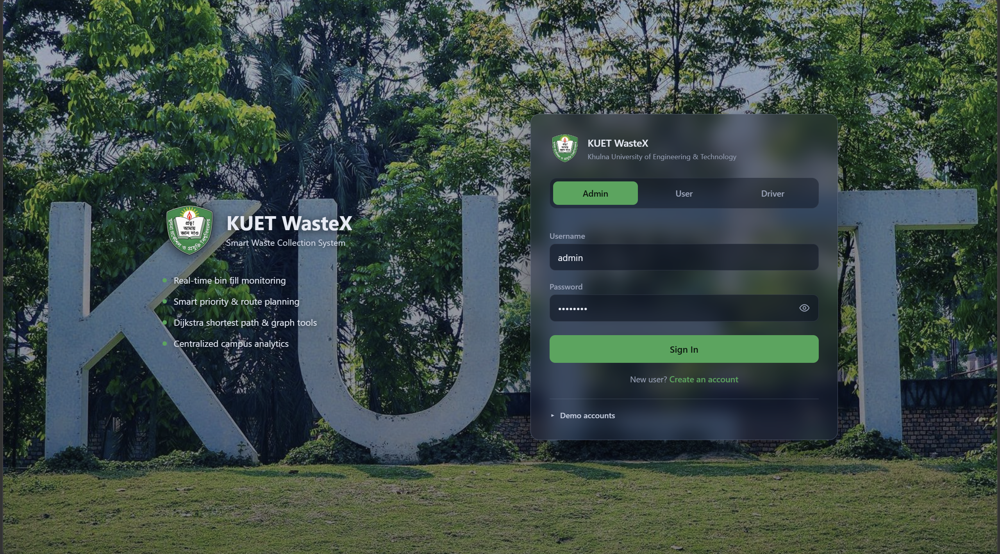

*Login page: role tabs for Admin, User and Driver.*

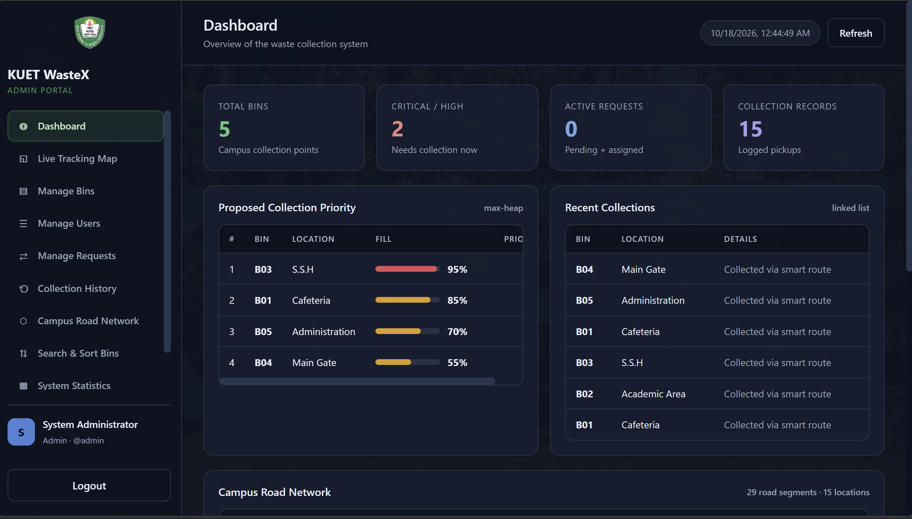

*Admin dashboard: live counts and bin status summary.*

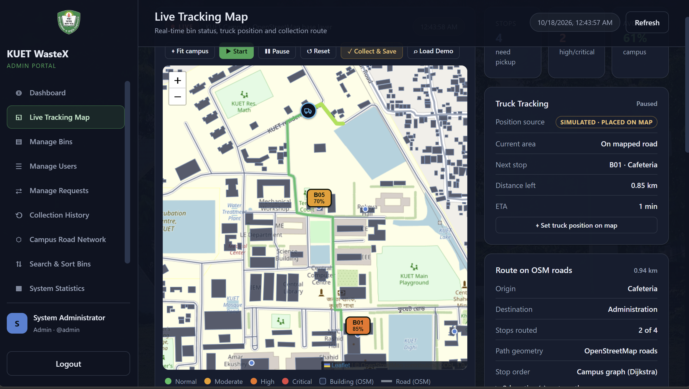

*Live tracking map: bins, planned route and truck position on OpenStreetMap.*

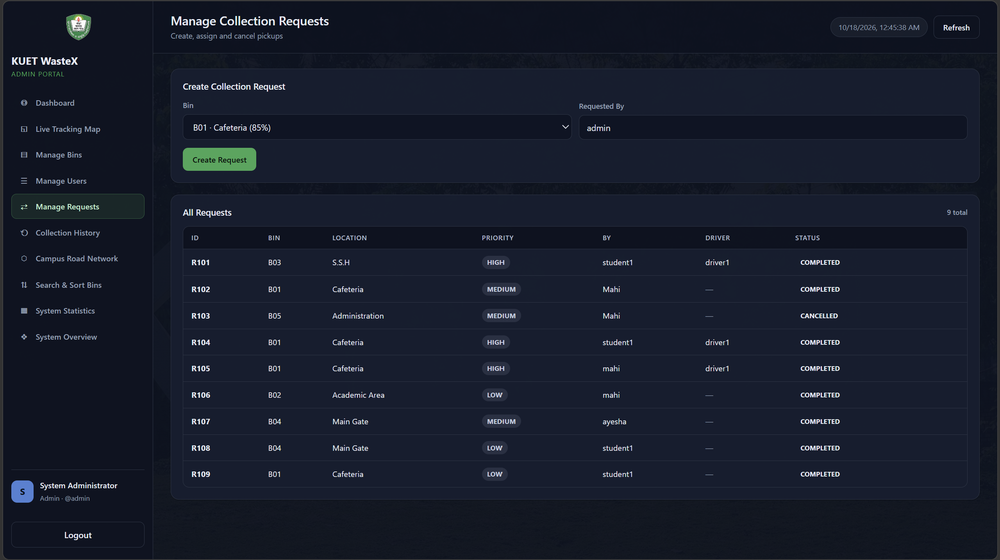

*Manage collection requests: assign, cancel and follow requests.*

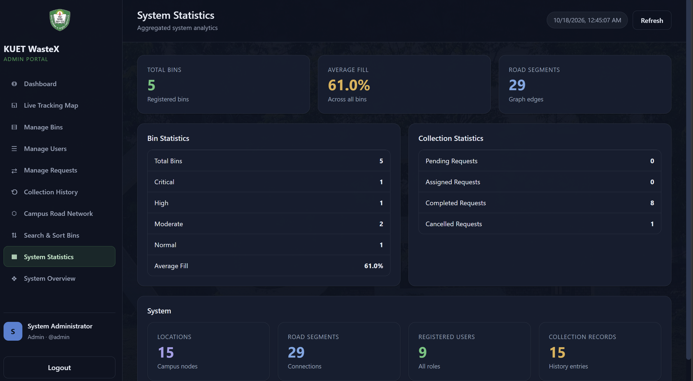

*System statistics: aggregated analytics across bins, requests and users.*

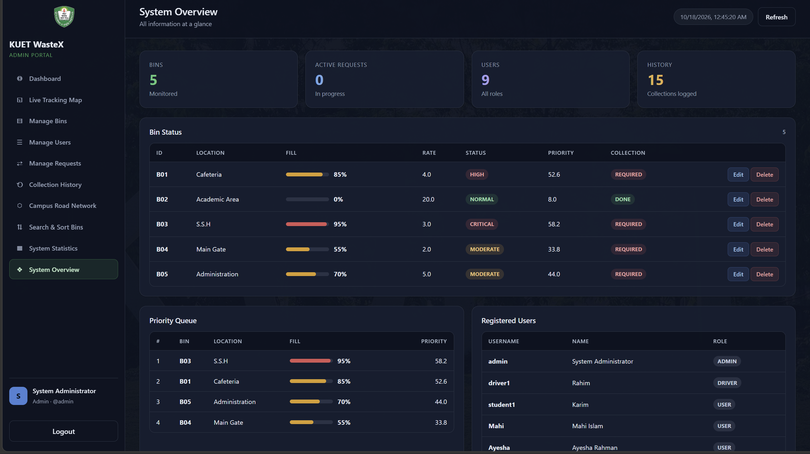

*System overview: the complete system state on one screen.*

## C++ Core Engine

The console application is where the hand-written data structures run. Representative screenshots; the full set of 45 is in `WasteX_Report_Screenshots_console/`.

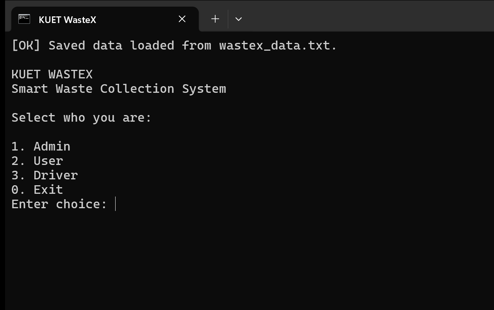

*Startup: role selection (Admin, User, Driver) with saved data loaded from `wastex_data.txt`.*

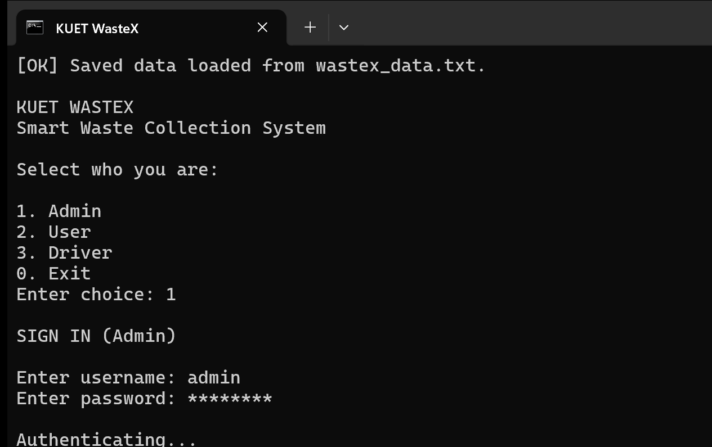

*Admin sign-in.*


*Admin dashboard.*

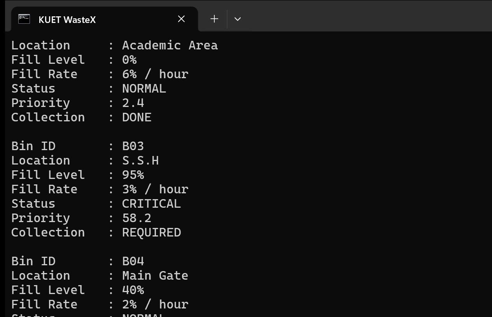

*Bin details: fill level, fill rate, status and priority.*

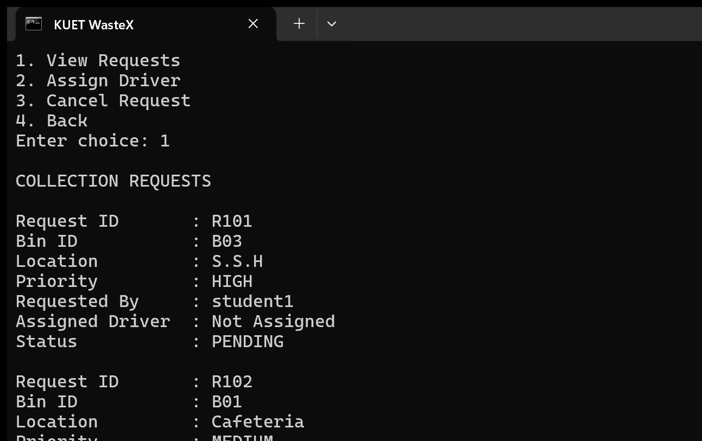

*Collection requests with priority and status.*

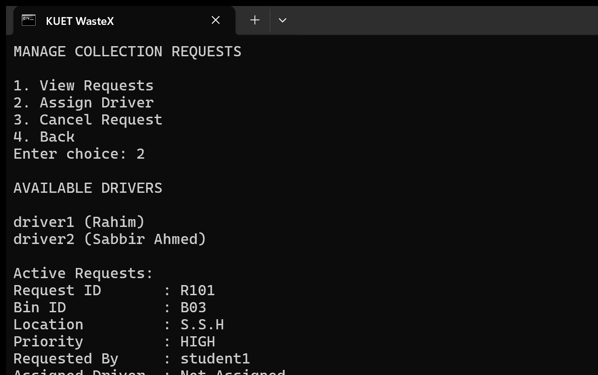

*Assigning a driver to a collection request.*

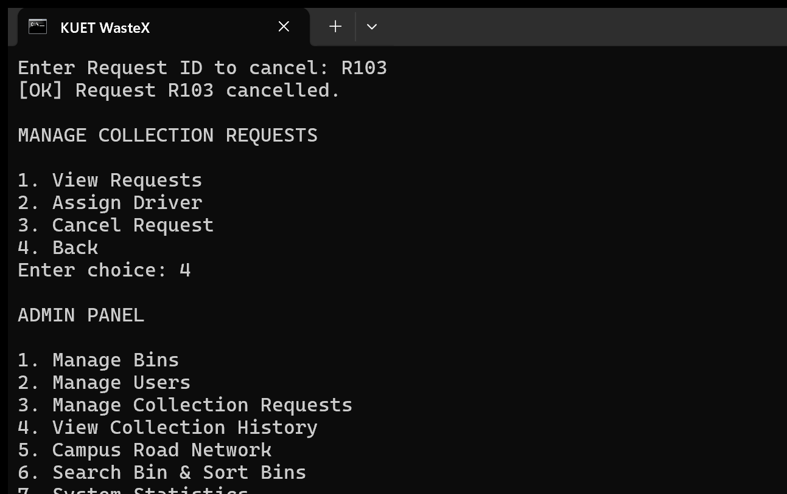

*Collection history, stored as a linked list.*

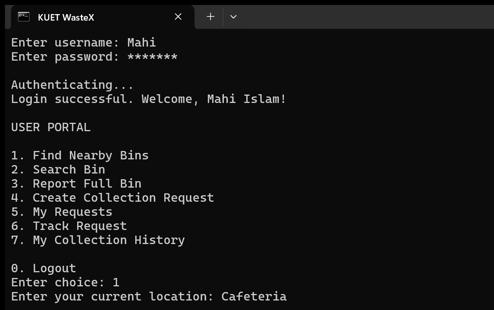

*Nearby bins ordered by Dijkstra shortest-path distance.*

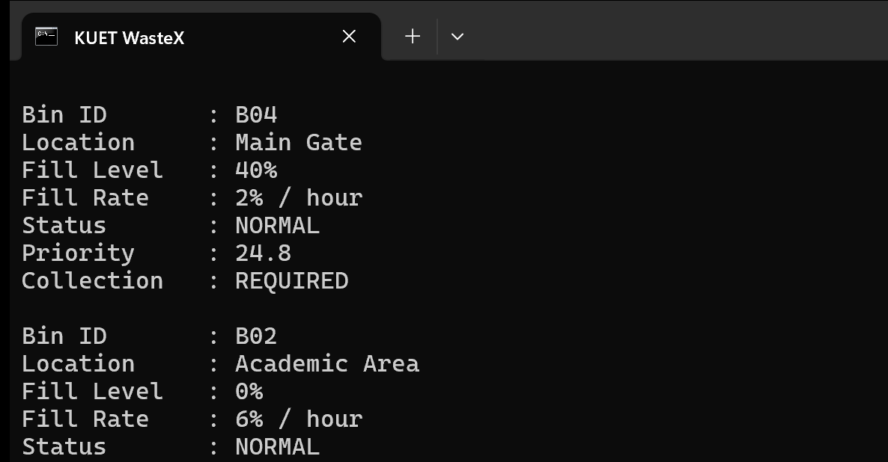

*Bins sorted by fill level using merge sort.*

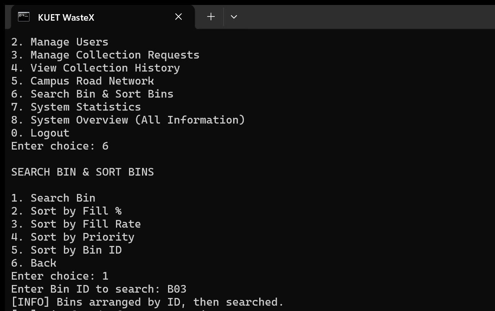

*Binary search by bin ID, showing the number of comparisons.*

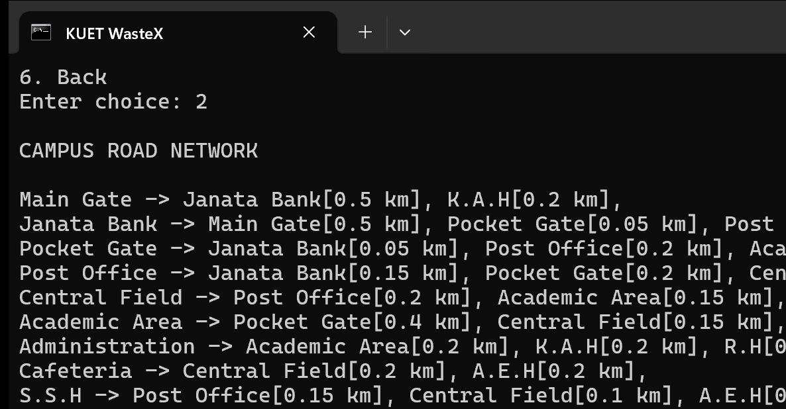

*Campus road network: weighted adjacency list built from `Graph.cpp`.*

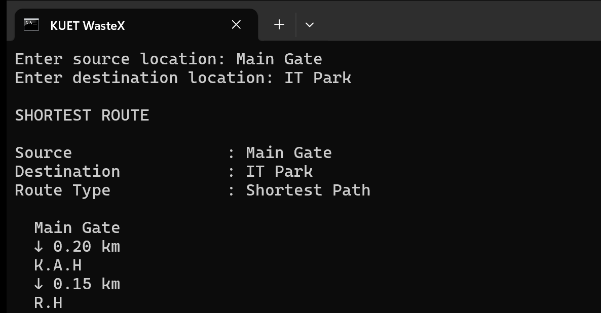

*Dijkstra shortest route between two campus locations.*

## Repository Structure

```
KUET WasteX/
├── main.cpp                       Console menus and role panels (Admin, User, Driver)
├── Graph.h / Graph.cpp            Campus road network with BFS and DFS
├── Dijkstra.h                     Weighted shortest paths
├── LinkedList.h / LinkedList.cpp  Collection history (linked list)
├── Stack.h                        Stack used to reverse Dijkstra paths
├── Queue.h                        FIFO queue of pending collection requests
├── PriorityQueue.h                Max-heap ordering bins by priority
├── BST.h                          Binary search tree of campus locations
├── SortSearch.h                   Merge sort and binary search on bins
├── Bin.h, User.h, Request.h       Core data models
├── DataStore.h                    Load/save wastex_data.txt
├── UI.h                           Console output helpers
├── Makefile                       Targets: all, WasteX, reset, clear, clean
├── build.bat / WasteX.bat         One-click build (WasteX.bat builds and runs)
├── setup.bat / clear.bat          Optional PATH setup and data reset
├── start-webui.bat                Starts the web dashboard and opens the browser
├── wastex_data.txt                Shared data file (created at first run)
├── webui/
│   ├── server.js                  HTTP server and JSON API (Node built-ins only)
│   ├── data.js                    Data layer and JavaScript ports of the algorithms
│   ├── public/                    Web front end (index.html, app.js, styles.css)
│   └── mapdata/                   Campus GeoJSON: roads, buildings, nodes, metadata
├── WasteX_Report_Screenshots_console/   Console screenshots used in this README
├── WasteX_Report_Screenshots_webui/     Web dashboard screenshots used in this README
└── WasteX webui screenshots/            Original dashboard captures (kept unedited)
```

## Notes and Limitations

- The console app is built and tested on Windows; its persistence layer and password input use Windows APIs.
- Accounts and data are stored in plain text in `wastex_data.txt`. This is a coursework project, not hardened for production.
- The truck marker on the live map is a simulated animation along the computed route; there is no GPS hardware involved.
- The campus road network view only draws road segments whose endpoints have been placed on the map; admins can place the remaining locations from the map view.
- Internet access is required for OpenStreetMap tiles and the Leaflet CDN; the bundled road and building data keeps the map meaningful when tiles are unavailable.
