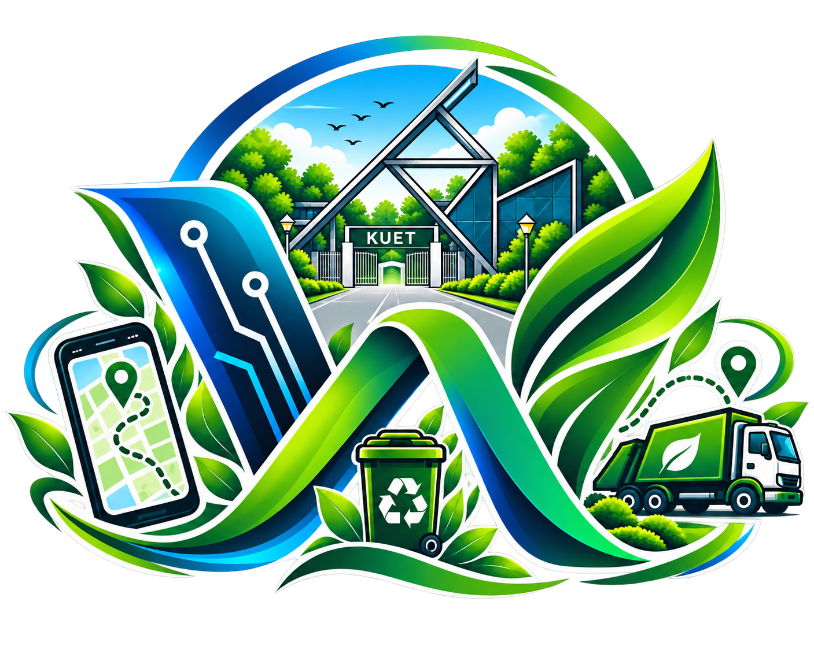

<div align="center">



# KUET WasteX

**Smart campus waste management — a C++ data-structures core with a live web dashboard.**

*Track every bin on campus, collect in priority order, and drive the shortest routes.*


</div>

---

## Table of Contents

1. [Overview](#overview)
2. [Key Features](#key-features)
3. [System Architecture](#system-architecture)
4. [Data Structures and Algorithms](#data-structures-and-algorithms)
5. [Data File Format](#data-file-format)
6. [Screenshots](#screenshots)
7. [Tech Stack](#tech-stack)
8. [Getting Started](#getting-started)
9. [Repository Structure](#repository-structure)
10. [Project Team](#project-team)
11. [Future Improvements](#future-improvements)
12. [License and Credits](#license-and-credits)
13. [Notes and Limitations](#notes-and-limitations)

## Overview

KUET WasteX is a solid-waste management system for a university campus, built as a coursework project around hand-implemented data structures and algorithms. It ships as two programs that share one plain-text database, `wastex_data.txt`:

- **A C++17 console application** — the core engine: bins, users, requests and a campus road graph managed entirely with data-structures written from scratch (linked list, stack, FIFO queue, max-heap priority queue, binary search tree, weighted graph with BFS/DFS, Dijkstra, merge sort and binary search).
- **A Node.js web dashboard** — a role-based front end served by a dependency-free HTTP server (Node built-ins only), featuring live OpenStreetMap tracking of bins and the collection truck, a visual campus road network, and analytics screens.

The system models 15 campus locations connected by 29 weighted road segments. Bin status is derived from two monitored values (fill level and fill rate per hour): `CRITICAL` at 90% or above, `HIGH` at 75%+, `MODERATE` at 50%+, otherwise `NORMAL`. Collection priority is computed as `fill × 0.6 + fill rate × 0.4`.

## Key Features

### Admin

- Dashboard with live system counts, bin status summary and collection overview.
- Add, update, search, list and delete bins; inspect fill level, fill rate, status and priority.
- View, search and cancel collection requests; assign drivers to requests.
- Manage users: list users, add User / Driver / Admin accounts, remove accounts.
- System statistics and a one-screen complete system overview.
- Interactive campus road network: explore the weighted graph, prepare locations on the map, preview shortest routes between any two campus locations.
- Sort bins by fill, fill rate, priority or ID; binary search a bin by ID with a visible comparison count.

### User

- Register and sign in with self-service credentials.
- Browse nearby bins ordered by shortest walking distance (Dijkstra).
- File collection requests for bins and follow their status.
- Review collection history and system statistics.

### Driver

- View assigned collection requests and priority bins.
- Smart collection: collects bins in priority order, with aggregated shortest routes between stops.
- Find the shortest route between two campus locations.
- Collect a bin and update the truck's current location.
- View collection history.

The web dashboard adds live OpenStreetMap tracking on top of all roles: bins drawn at their campus coordinates, the truck moving along the planned route, admin tools to place campus locations on the map, and a branded loading interstitial when a session opens.

## System Architecture

The two applications are independent programs that communicate through one plain-text database file, `wastex_data.txt`.

- The C++ console app loads the file at startup and saves after every change.
- The Node.js server reads the file fresh on every API request and writes it back after mutations (`webui/data.js`).
- The web server never launches the C++ binary; it re-implements the same logic (graph building, BFS/DFS, Dijkstra, priority ordering, sorting, binary search) in JavaScript. Running one interface after the other keeps both views consistent; editing through both at the same time is last-write-wins.

Web dashboard internals:

- `webui/server.js` — HTTP server and JSON API using only Node built-ins (`http`, `fs`, `path`), serving the static front end and the API on port 3000 (`PORT` environment variable to override).
- `webui/public/` — Leaflet-based front end (`index.html`, `app.js`, `styles.css`, `cursorfx.js`). Leaflet is loaded from a CDN and the map uses OpenStreetMap tiles.
- `webui/mapdata/` — bundled campus map data: `kuet_buildings.geojson`, `kuet_roads.geojson`, `campus_nodes.json`, `metadata.json`, plus runtime files `manual_coords.json` and `driver_position.json`.
- Route planning on the map snaps coordinates to the nearest road vertex and runs Dijkstra over the actual road geometry using haversine distances (`buildRoadGraph`, `routeOnRoads` in `webui/data.js`).
- Map data: (c) OpenStreetMap contributors, ODbL 1.0.

## Data Structures and Algorithms

| Implementation | File | Used for |
| --- | --- | --- |
| Singly linked list | `LinkedList.h` / `LinkedList.cpp` | Collection history records (newest first): add, display, search by bin ID, delete, clear |
| Stack | `Stack.h` | Reversing the Dijkstra path for display |
| FIFO queue | `Queue.h` | Pending collection request queue (bin IDs), saved and restored with the data file |
| Max-heap priority queue | `PriorityQueue.h` | Collection order by computed bin priority |
| Binary search tree | `BST.h` | Campus location registry (15 locations); in-order listing in the system overview |
| Weighted graph (adjacency list) | `Graph.h` / `Graph.cpp` | Campus road network: 15 locations, 29 roads with kilometer weights; BFS and DFS traversal |
| Dijkstra | `Dijkstra.h` | Shortest routes between campus locations; nearby bins; smart collection routes |
| Merge sort and binary search | `SortSearch.h` | Sorting bins by fill, fill rate, priority or ID; binary search by bin ID with comparison count |

Related rules live in `Bin.h`: status is `CRITICAL` at 90% or above, `HIGH` at 75%+, `MODERATE` at 50%+, otherwise `NORMAL`, and priority is `fill × 0.6 + fill rate × 0.4`.

The web dashboard ports the same algorithm set to JavaScript in `webui/data.js`: graph construction, BFS/DFS, Dijkstra, priority ordering (`priorityList`), sorting (`sortBins`), binary search by ID (`binarySearchById`), plus the road-level router described above.

## Data File Format

`wastex_data.txt` is a small tag-based, pipe-separated format, written and read by both the console app (`DataStore.h`) and the web server (`webui/data.js`).

```
WASTEX_DATA_V1
NEXTID|110
LOCATION|Cafeteria
BINCOUNT|5
B01|Cafeteria|85.00|4.00
B02|Academic Area|0.00|20.00
...
USERCOUNT|9
username|password|role|fullName
...
```

| Tag | Meaning |
| --- | --- |
| `NEXTID` | Counter for the next collection request ID |
| `LOCATION` | The truck's current campus location |
| `BINCOUNT` + rows | `binId \| location \| fillLevel \| fillRatePerHour` |
| `USERCOUNT` + rows | `username \| password \| role \| fullName` |
| `REQCOUNT` + rows | `requestId \| binId \| location \| priority \| status \| requestedBy \| assignedDriver` |
| `HISTCOUNT` + rows | `binId \| location \| description` |
| `ROADCOUNT` + rows | `from \| to \| distanceInKm` |
| `QCOUNT` + rows | One pending bin ID per line |

Pipe characters inside text fields are stored as `/`. If the file is missing, the console app recreates default seed data on the next launch and the web dashboard falls back to built-in defaults.

## Screenshots

### Web dashboard (http://localhost:3000)

| | |
| --- | --- |
|  |  |
| *Landing page: role tabs for Admin, User and Driver over the KUET campus background.* | *Branded loading interstitial shown while a session opens.* |
|  |  |
| *The loading interstitial, with idle trail fragments in view.* | *Admin dashboard: live counts, bin status summary and collection overview.* |
|  |  |
| *Admin dashboard, second view.* | *System statistics: aggregated analytics across bins, requests and users.* |
|  |  |
| *Live tracking map: bins, planned route and truck position on OpenStreetMap.* | *Campus road network over a real OpenStreetMap base layer; admins place campus locations on the map.* |
|  |  |
| *Schematic view of the weighted campus graph: 15 locations, 29 roads.* | *A Dijkstra search from a source node: the shortest route is highlighted and the destination marked.* |

### C++ core engine (console application)

Representative screenshots; the full set of 45 is in `WasteX_Report_Screenshots_console/`.

| | |
| --- | --- |
|  |  |
| *Startup: role selection (Admin, User, Driver) with saved data loaded from `wastex_data.txt`.* | *Admin sign-in.* |
|  |  |
| *Admin dashboard.* | *Bin details: fill level, fill rate, status and priority.* |
|  |  |
| *Collection requests with priority and status.* | *Assigning a driver to a collection request.* |
|  |  |
| *Collection history, stored as a linked list.* | *Nearby bins ordered by Dijkstra shortest-path distance.* |
|  |  |
| *Bins sorted by fill level using merge sort.* | *Binary search by bin ID, showing the number of comparisons.* |
|  |  |
| *Campus road network: weighted adjacency list built from `Graph.cpp`.* | *Dijkstra shortest route between two campus locations.* |

## Tech Stack

| Layer | Technology |
| --- | --- |
| Console engine | C++17 (`g++` / MinGW-w64), Windows console APIs |
| Web server | Node.js — built-in modules only (`http`, `fs`, `path`), no npm packages |
| Front end | Vanilla JavaScript, HTML5, CSS3 |
| Maps | Leaflet (loaded from a CDN) + OpenStreetMap tiles; custom GeoJSON campus data in `webui/mapdata/` |
| Storage | One shared plain-text file `wastex_data.txt` |

## Getting Started

### Prerequisites

- Windows with a C++17 compiler (`g++`, MinGW-w64) for the console app. It uses Windows console APIs (`windows.h`, masked password input via `_getch`).
- Node.js (LTS) for the web dashboard. No `npm install` is needed; the server uses only Node built-ins.
- Internet access for OpenStreetMap tiles and the Leaflet CDN.

### Installation

Clone or copy this repository into a local folder — nothing else has to be installed on top of the two prerequisites.

### Running the console application

The quickest way is to double-click `WasteX.bat`, which builds with all warnings enabled and launches the app. Or build manually:

```
g++ -std=c++17 main.cpp Graph.cpp LinkedList.cpp -o KUETWasteX.exe
KUETWasteX.exe
```

With make:

```
make          # build KUETWasteX.exe
make WasteX   # build and run
```

Optional one-time setup: run `setup.bat` to add the project folder to your user PATH; afterwards you can type `WasteX` from any terminal. `clear.bat` (or `make reset`) deletes the saved data so the next launch starts fresh.

### Running the web dashboard

Double-click `start-webui.bat`, or run:

```
node webui\server.js
```

Then open http://localhost:3000 in a browser (the batch file opens it automatically). Demo accounts for each role are listed on the login screen; new User accounts can be created with the sign-up form, and Admins can create Driver and Admin accounts from Manage Users.

## Repository Structure

```
KUET WasteX/
├── main.cpp                       Console menus and role panels (Admin, User, Driver)
├── Graph.h / Graph.cpp            Campus road network with BFS and DFS
├── Dijkstra.h                      Weighted shortest paths
├── LinkedList.h / LinkedList.cpp  Collection history (linked list)
├── Stack.h                        Stack used to reverse Dijkstra paths
├── Queue.h                        FIFO queue of pending collection requests
├── PriorityQueue.h                Max-heap ordering bins by priority
├── BST.h                          Binary search tree of campus locations
├── SortSearch.h                   Merge sort and binary search on bins
├── Bin.h, User.h, Request.h       Core data models
├── DataStore.h                    Load/save wastex_data.txt
├── UI.h                           Console output helpers
├── Makefile                       Targets: all, WasteX, reset, clear, clean
├── build.bat / WasteX.bat         One-click build (WasteX.bat builds and runs)
├── setup.bat / clear.bat          Optional PATH setup and data reset
├── start-webui.bat                Starts the web dashboard and opens the browser
├── wastex_data.txt                Shared data file (created at first run)
├── webui/
│   ├── server.js                  HTTP server and JSON API (Node built-ins only)
│   ├── data.js                    Data layer and JavaScript ports of the algorithms
│   ├── public/                    Web front end (index.html, app.js, styles.css, cursorfx.js)
│   └── mapdata/                   Campus GeoJSON: roads, buildings, nodes, metadata
├── WasteX_Report_Screenshots_console/   Console screenshots used in this README
├── WasteX_Report_Screenshots_webui/     Web dashboard screenshots used in this README
└── WasteX webui screenshots/            Original dashboard captures (kept unedited)
```

## Project Team

<div align="center">

| | |
| --- | --- |
|  |  |
| **Rahat Hasan Mahi** | **Ayesha Yesmin Moumita** |
| Student ID: 2407101 | Student ID: 2407104 |
| B.Sc. Engineering in Computer Science and Engineering | B.Sc. Engineering in Computer Science and Engineering |
| Khulna University of Engineering & Technology (KUET) | Khulna University of Engineering & Technology (KUET) |
| Khulna, Bangladesh | Khulna, Bangladesh |
| Email: mahi2407101@stud.kuet.ac.bd | Email: moumita2407104@stud.kuet.ac.bd |
| GitHub: [@RHMahi](https://github.com/RHMahi) &nbsp;·&nbsp; [LinkedIn](https://bd.linkedin.com/in/rahat-hasan-mahi) | GitHub: [@ayeshaawoM](https://github.com/ayeshaawoM) &nbsp;·&nbsp; [LinkedIn](https://bd.linkedin.com/in/ayesha-yesmin-moumita-a3a37b397) |

**Founder team — developed together from the first line of code to the report.**

</div>

## Future Improvements

The following are **proposed** directions for future work — **not yet implemented** in this codebase:

- Replace plain-text passwords with salted hashes and add session management.
- Wire real hardware (GPS or GSM reports) into the live truck view instead of the simulated animation.
- Complete map-based editing so the full road network renders its geometry rather than subset segments.
- Add report export (CSV / PDF) for collection statistics.
- Add scheduled pickups and automatic request escalation for critical bins.

## License and Credits

- This repository currently ships without a license file; it is a university coursework project distributed for educational review.
- Map data and tiles: (c) [OpenStreetMap](https://www.openstreetmap.org/copyright) contributors, ODbL 1.0.
- Map interaction: [Leaflet](https://leafletjs.com/) (loaded from a CDN at runtime, not bundled).

## Notes and Limitations

- The console app is built and tested on Windows; its persistence layer and password input use Windows APIs.
- Accounts and data are stored in plain text in `wastex_data.txt`. This is a coursework project, not hardened for production.
- The truck marker on the live map is a simulated animation along the computed route; there is no GPS hardware involved.
- The campus road network view only draws road segments whose endpoints have been placed on the map; admins can place the remaining locations from the map view.
- Internet access is required for OpenStreetMap tiles and the Leaflet CDN; the bundled road and building data keeps the map meaningful when tiles are unavailable.
